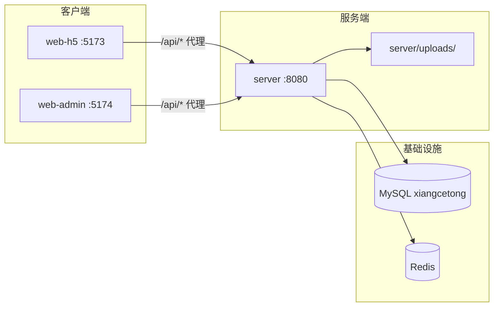
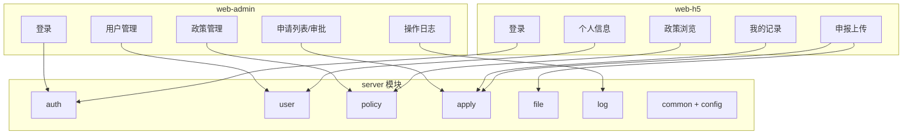
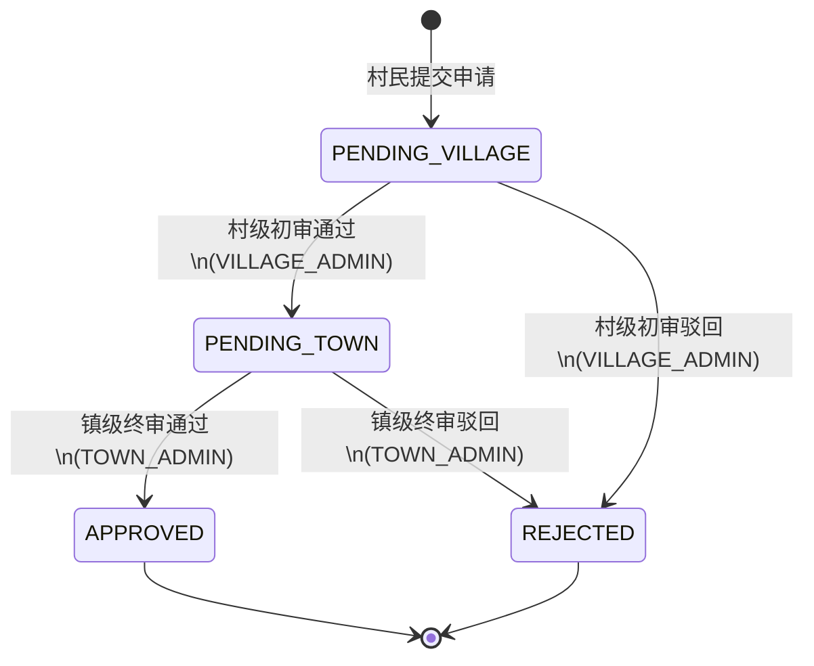
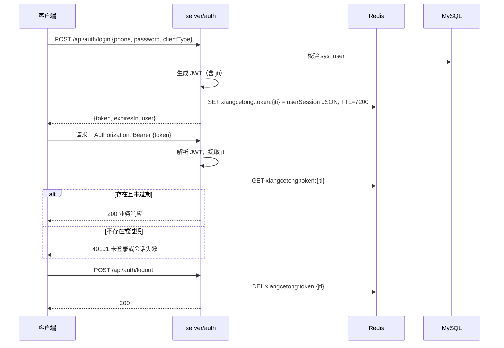

# 乡策通｜系统架构说明

> **版本**：2.0  
> **日期**：2026-10-09  
> **状态**：已定稿，供 api-designer / backend / frontend 下游使用  
> **上游依赖**：[`docs/01-mvp-requirements.md`](./01-mvp-requirements.md)

---

## 1. 总览

乡策通采用 **三工程 monorepo** 布局，实现「政策查阅 → H5 申报 → 村初审 / 镇终审 → 结果查询」最小闭环。

| 工程 | 职责 | 技术栈 | 端口 |
|------|------|--------|------|
| `server/` | REST API、鉴权、数据权限、状态机、文件存储 | Spring Boot 3.x + MyBatis + Maven | **8080** |
| `web-h5/` | 村民端（手机浏览器） | Vue 3 + Vite + Vant 4 | **5173** |
| `web-admin/` | PC 管理端（村镇 / 系统管理员） | Vue 3 + Vite + Element Plus | **5174** |

**数据库铁律**：沿用 MySQL 库 **`xiangcetong`** 已有 **6 张表**，禁止删库重建，禁止改表名、删字段或破坏性 DDL。字段不足时仅允许增量 `ALTER TABLE` 新增可空字段，且须单独评审。

---

## 2. 部署拓扑



### 2.1 本地开发端口与代理

| 服务 | 地址 | 说明 |
|------|------|------|
| 后端 | `http://localhost:8080` | Spring Boot 主服务 |
| H5 | `http://localhost:5173` | Vite dev server |
| Admin | `http://localhost:5174` | Vite dev server |

**前端代理约定**（`web-h5/vite.config.ts`、`web-admin/vite.config.ts` 均需配置）：

```text
/api  →  http://localhost:8080
```

- 前端 axios `baseURL` 统一为 `/api`
- 后端 Controller 路径前缀统一为 `/api`（如 `/api/auth/login`）
- 静态材料访问：后端映射 `/uploads/**` → 物理目录 `server/uploads/`

### 2.2 启动命令

```bash
# 后端
cd server && mvn spring-boot:run          # 或根目录 mvn -pl server spring-boot:run

# 村民端
cd web-h5 && npm run dev                  # :5173

# 管理端
cd web-admin && npm run dev               # :5174
```

---

## 3. 工程目录结构

### 3.1 根目录

```text
xiangcetong/
├── docs/                    # 需求 / 架构 / API 契约（只读参考，实现方不改 architect 文档）
│   ├── 01-mvp-requirements.md
│   ├── 02-architecture.md   # 本文档
│   └── 03-api-contract.md   # api-designer 产出
├── server/                  # 后端（backend-engineer 独占）
├── web-h5/                  # 村民 H5（frontend-engineer，H5 轮次）
└── web-admin/               # PC 管理端（frontend-engineer，Admin 轮次）
```

### 3.2 server/（Spring Boot）

```text
server/
├── pom.xml
├── uploads/                          # 上传材料物理目录（gitignore，运行时自动创建）
├── src/main/java/com/xiangcetong/
│   ├── XiangcetongApplication.java
│   ├── config/                       # 安全、Redis、MyBatis、WebMvc、CORS
│   ├── common/                       # 统一响应、异常、错误码、分页、工具类
│   ├── auth/                         # 登录、JWT 签发/校验、会话
│   ├── user/                         # sys_user、villager_info CRUD
│   ├── policy/                       # subsidy_policy CRUD、缓存
│   ├── apply/                        # subsidy_apply、状态机、初审/终审
│   ├── file/                         # 本地上传、静态资源映射
│   └── log/                          # apply_flow_log、operation_log
└── src/main/resources/
    ├── application.yml
    ├── mapper/                       # MyBatis XML（按模块分子目录）
    └── db/
        └── seed.sql                  # 演示种子数据（可重复执行策略由实现定）
```

**包内分层约定**（每个业务包内保持一致）：

```text
com.xiangcetong.{module}/
├── controller/
├── service/          # 接口 + impl/
├── mapper/
├── entity/           # 与表一一对应
├── dto/              # 请求/响应对象
└── enums/            # 模块专属枚举（全局枚举放 common）
```

### 3.3 web-h5/（Vue 3 + Vant）

```text
web-h5/
├── index.html
├── vite.config.ts        # port: 5173, proxy /api → 8080
├── package.json
└── src/
    ├── main.ts
    ├── App.vue
    ├── api/              # 按资源分文件：auth、user、policy、apply、file
    ├── router/
    ├── stores/           # Pinia：user、token
    ├── views/            # login、profile、policy、apply、records
    ├── components/
    └── utils/            # request 封装、auth、format
```

### 3.4 web-admin/（Vue 3 + Element Plus）

```text
web-admin/
├── index.html
├── vite.config.ts        # port: 5174, proxy /api → 8080
├── package.json
└── src/
    ├── main.ts
    ├── App.vue
    ├── api/              # auth、user、policy、apply、log、file
    ├── router/           # 路由守卫 + 角色 meta
    ├── stores/
    ├── layouts/          # 侧边栏布局
    ├── views/            # login、user、policy、apply、audit-log
    ├── components/
    └── utils/
```

---

## 4. 模块划分与边界



| 模块 | 包路径 | 负责表 | 职责 |
|------|--------|--------|------|
| **auth** | `com.xiangcetong.auth` | `sys_user`（只读登录字段） | 手机号+密码登录、JWT 签发、Redis 会话、登出、端类型校验（H5/Admin） |
| **user** | `com.xiangcetong.user` | `sys_user`, `villager_info` | 用户 CRUD（管理员）、村民个人信息维护 |
| **policy** | `com.xiangcetong.policy` | `subsidy_policy` | 政策 CRUD、上下架；H5 只读 ONLINE |
| **apply** | `com.xiangcetong.apply` | `subsidy_apply` | 申报提交、列表/详情、初审/终审、**状态机强制执行** |
| **file** | `com.xiangcetong.file` | — | 图片上传校验、写入 `server/uploads/`、返回可访问 URL |
| **log** | `com.xiangcetong.log` | `apply_flow_log`, `operation_log` | 流转留痕写入、操作审计查询 |
| **common** | `com.xiangcetong.common` | — | `Result<T>`、错误码、全局异常处理、分页模型 |
| **config** | `com.xiangcetong.config` | — | Security 过滤器链、Redis/MyBatis/WebMvc 配置 |

**模块通信方式**：

- 前后端：**REST over HTTP/JSON**，统一前缀 `/api`
- 后端模块间：**同进程 Spring Bean 调用**（Service 注入），禁止跨模块直接访问 Mapper
- 跨模块写日志：`apply` 审批完成后调用 `log` 模块 Service 写 `apply_flow_log`；各模块关键操作调用 `log` 写 `operation_log`
- 共享类型：后端 `entity`/`dto`/`enums` 各模块自有；前端无跨工程共享包（H5 与 Admin 各自维护 `api/` 类型）

---

## 5. 数据库实体映射（沿用 6 表）

| 实体类（建议名） | 表名 | 关键字段 |
|------------------|------|----------|
| `SysUser` | `sys_user` | `id, phone, password_hash, name, role, county_code, town_code, village_code, created_at` |
| `VillagerInfo` | `villager_info` | `id, user_id, county_name, town_name, village_name, plant_type, bank_card, updated_at` |
| `SubsidyPolicy` | `subsidy_policy` | `id, title, content, conditions, standard, consult_phone, status, created_at, updated_at` |
| `SubsidyApply` | `subsidy_apply` | `id, user_id, policy_id, material_urls, status, village_code, town_code, first_by, first_opinion, first_at, final_by, final_opinion, final_at, created_at, updated_at` |
| `ApplyFlowLog` | `apply_flow_log` | `id, apply_id, from_status, to_status, operator_id, opinion, created_at` |
| `OperationLog` | `operation_log` | `id, user_id, action, target, detail, created_at` |

**字段约定**：

- `subsidy_apply.material_urls`：JSON 数组字符串，如 `["/uploads/2026/10/abc.jpg"]`
- `subsidy_policy.status`：`ONLINE` / `OFFLINE`（H5 仅展示 `ONLINE`）
- `sys_user.role`：`VILLAGER` | `VILLAGE_ADMIN` | `TOWN_ADMIN` | `SYS_ADMIN`
- 申报提交时：从村民 `villager_info.village_name` 与 `sys_user.town_code` 写入 `subsidy_apply.village_code`、`town_code`（便于数据权限过滤，无需联表）

---

## 6. 角色与数据权限

### 6.1 四角色定义

| 角色值 | 端 | 能力 | 禁止 |
|--------|-----|------|------|
| `VILLAGER` | H5 | 个人信息、政策浏览、申报、查本人记录 | 访问 Admin 接口 |
| `VILLAGE_ADMIN` | Admin | 本村 `PENDING_VILLAGE` 申请列表、初审通过/驳回 | 终审、用户/政策维护 |
| `TOWN_ADMIN` | Admin | 本镇 `PENDING_TOWN` 申请列表、终审通过/驳回 | 初审、用户/政策维护 |
| `SYS_ADMIN` | Admin | 用户 CRUD、政策 CRUD、操作日志、申请列表**只读** | **任何审批操作** |

### 6.2 数据权限规则（后端 Service/SQL 层强制）

| 角色 | 资源 | 过滤规则 |
|------|------|----------|
| `VILLAGER` | 申请 | `subsidy_apply.user_id = 当前用户 id` |
| `VILLAGER` | 政策 | `status = 'ONLINE'` |
| `VILLAGE_ADMIN` | 申请 | `village_code = 当前用户 village_code` |
| `VILLAGE_ADMIN` | 审批 | 仅当 `status = 'PENDING_VILLAGE'` 且 village 匹配 |
| `TOWN_ADMIN` | 申请 | `town_code = 当前用户 town_code AND status = 'PENDING_TOWN'`（列表默认）；详情可读本镇已进入终审链路的单 |
| `TOWN_ADMIN` | 审批 | 仅当 `status = 'PENDING_TOWN'` 且 town 匹配 |
| `SYS_ADMIN` | 申请 | 无区域限制，**只读**，接口层拒绝 POST 审批 |
| `SYS_ADMIN` | 用户/政策/日志 | 全镇可见，按接口 RBAC 控制写操作 |

### 6.3 端类型隔离

登录接口区分 `clientType`：

| clientType | 允许角色 |
|------------|----------|
| `H5` | 仅 `VILLAGER` |
| `ADMIN` | `VILLAGE_ADMIN`, `TOWN_ADMIN`, `SYS_ADMIN` |

JWT Payload 建议携带：`sub`(userId), `role`, `countyCode`, `townCode`, `villageCode`, `clientType`, `jti`。

**权限 enforcement 落点**：

1. **config 层**：JWT 过滤器、角色注解（如 `@PreAuthorize`）
2. **apply 模块 Service 层**：状态机迁移校验 + 数据权限 WHERE 条件
3. **Controller 层**：端类型与角色双重校验
4. **前端**：菜单/按钮按角色隐藏（**不可替代后端校验**）

---

## 7. 申请状态机

### 7.1 状态枚举

存于 `subsidy_apply.status`，**全局唯一命名**，禁止第二套中文码入库：

| 状态值 | 含义 | 中文展示（前端） |
|--------|------|------------------|
| `PENDING_VILLAGE` | 待村初审 | 待村级审核 |
| `PENDING_TOWN` | 待镇终审 | 待镇级审核 |
| `APPROVED` | 已通过 | 已通过 |
| `REJECTED` | 已驳回 | 已驳回 |

### 7.2 状态迁移图



### 7.3 迁移规则（apply 模块 Service 事务内执行）

| 事件 | 前置状态 | 目标状态 | 操作角色 | 更新字段 | 流转日志 |
|------|----------|----------|----------|----------|----------|
| 提交申请 | — | `PENDING_VILLAGE` | `VILLAGER` | 新建记录 + `material_urls` | `from=null, to=PENDING_VILLAGE` |
| 初审通过 | `PENDING_VILLAGE` | `PENDING_TOWN` | `VILLAGE_ADMIN` | `first_by, first_opinion, first_at` | 写入 `apply_flow_log` |
| 初审驳回 | `PENDING_VILLAGE` | `REJECTED` | `VILLAGE_ADMIN` | `first_by, first_opinion, first_at` | 写入 `apply_flow_log` |
| 终审通过 | `PENDING_TOWN` | `APPROVED` | `TOWN_ADMIN` | `final_by, final_opinion, final_at` | 写入 `apply_flow_log` |
| 终审驳回 | `PENDING_TOWN` | `REJECTED` | `TOWN_ADMIN` | `final_by, final_opinion, final_at` | 写入 `apply_flow_log` |

**铁律**：

- 非法迁移（如从 `APPROVED` 再审批）→ 业务错误码 `40003`，HTTP 400
- `SYS_ADMIN` 调用任何审批接口 → `40301`，HTTP 403
- 每次成功迁移在同一事务内：`UPDATE subsidy_apply` + `INSERT apply_flow_log` + `INSERT operation_log`（action 如 `APPLY_FIRST_APPROVE`）

---

## 8. JWT + Redis 会话约定

### 8.1 流程



### 8.2 Redis Key 规范（前缀 `xiangcetong:`）

| Key 模式 | 值 | TTL | 用途 |
|----------|-----|-----|------|
| `xiangcetong:token:{jti}` | 用户会话 JSON（userId, role, townCode, villageCode, clientType） | 7200s（2h，可配置） | 登录态校验 |
| `xiangcetong:policy:list` | 上架政策列表缓存 | 300s | 政策列表加速（可选，MVP 可实现） |
| `xiangcetong:login:fail:{phone}` | 失败次数 | 900s | 预留防 brute-force（MVP 可选） |

### 8.3 Token 约定

- Header：`Authorization: Bearer <jwt>`
- JWT 签名算法：HS256（密钥走环境变量 `JWT_SECRET`）
- 登出 / 踢下线：删除 Redis 中对应 `jti` 即可失效，无需 JWT 黑名单表
- 401 场景：未携带 Token、Token 无效、Redis 会话不存在或过期

---

## 9. 文件上传方案

| 项 | 约定 |
|----|------|
| 物理目录 | `server/uploads/`（相对 server 工程根目录） |
| 存储结构 | `uploads/{yyyy}/{MM}/{uuid}.{ext}` |
| 允许类型 | JPG、JPEG、PNG |
| 大小限制 | 单张 ≤ 5MB |
| 接口 | `POST /api/file/upload`（multipart），返回 `{ url: "/uploads/..." }` |
| 访问 | Spring WebMvc 映射 `GET /uploads/**` → `file:{uploadsDir}/` |
| 入库 | 申报时将 URL 数组 JSON 写入 `subsidy_apply.material_urls` |
| 权限 | 登录后可上传；删除/覆盖 MVP 不做 |

---

## 10. 全局规范

### 10.1 统一响应体

所有 REST 接口（含错误）返回 JSON：

```json
{
  "code": 0,
  "message": "success",
  "data": {}
}
```

| 字段 | 类型 | 说明 |
|------|------|------|
| `code` | int | **0 = 成功**；非 0 = 业务/鉴权错误 |
| `message` | string | 人类可读提示，前端 Toast 直接展示 |
| `data` | object/array/null | 成功时载荷；失败时可为 null |

**HTTP 状态码与 code 配合**：

| HTTP | code 范围 | 场景 |
|------|-----------|------|
| 200 | 0 | 成功 |
| 400 | 400xx | 参数校验、非法状态迁移 |
| 401 | 401xx | 未登录、Token 失效 |
| 403 | 403xx | 无角色权限、端类型不匹配、SYS_ADMIN 审批 |
| 404 | 404xx | 资源不存在或无权访问（避免泄露） |
| 500 | 500xx | 服务器内部错误 |

### 10.2 错误码表（MVP 最小集）

| code | message（示例） | HTTP |
|------|-----------------|------|
| 0 | success | 200 |
| 40001 | 参数校验失败 | 400 |
| 40002 | 手机号或密码错误 | 400 |
| 40003 | 申请状态不允许该操作 | 400 |
| 40101 | 未登录或会话已失效 | 401 |
| 40301 | 无权限访问该资源 | 403 |
| 40302 | 该角色无法使用此客户端 | 403 |
| 40401 | 资源不存在 | 404 |
| 50001 | 系统繁忙，请稍后重试 | 500 |

完整接口级错误码由 `docs/03-api-contract.md` 补充，**不得与本表冲突**。

### 10.3 命名规范

| 层级 | 规范 | 示例 |
|------|------|------|
| 数据库表/字段 | snake_case，沿用已有 | `subsidy_apply`, `first_opinion` |
| Java 类 | PascalCase | `SubsidyApply`, `ApplyService` |
| Java 字段 | camelCase，MyBatis 映射下划线 | `firstOpinion` |
| API 路径 | kebab-case 或 REST 资源名 | `/api/subsidy-applies`, `/api/auth/login` |
| JSON 字段 | camelCase | `materialUrls`, `createdAt` |
| 枚举值 | UPPER_SNAKE | `PENDING_VILLAGE`, `VILLAGER` |
| Redis Key | `xiangcetong:` 前缀 + 小写冒号分段 | `xiangcetong:token:{jti}` |
| 前端文件 | kebab-case | `apply-list.vue`, `use-auth.ts` |

### 10.4 分页约定

列表接口统一 query：`page`（从 1 开始）、`size`（默认 10，最大 50）。

```json
{
  "code": 0,
  "message": "success",
  "data": {
    "list": [],
    "total": 100,
    "page": 1,
    "size": 10
  }
}
```

### 10.5 日志规范

| 类型 | 表 | 写入时机 |
|------|-----|----------|
| 流转日志 | `apply_flow_log` | 申请创建、每次审批状态变更 |
| 操作审计 | `operation_log` | 登录/登出、政策变更、用户变更、审批操作 |

`operation_log.action` 建议：`LOGIN`, `LOGOUT`, `POLICY_CREATE`, `POLICY_UPDATE`, `USER_CREATE`, `APPLY_SUBMIT`, `APPLY_FIRST_APPROVE`, `APPLY_FIRST_REJECT`, `APPLY_FINAL_APPROVE`, `APPLY_FINAL_REJECT`。

---

## 11. 文件所有权与协作规则

> **一次一文件一人**：下游实现 Agent 必须遵守边界，避免跨目录冲突。

| 主责 | 负责路径 | 禁止修改 |
|------|----------|----------|
| **architect** | `docs/02-architecture.md` | 业务代码 |
| **api-designer** | `docs/03-api-contract.md` | `server/`, 前端工程 |
| **backend-engineer** | `server/**` | `web-h5/`, `web-admin/`, `docs/01*.md`, `docs/02*.md` |
| **frontend-engineer（H5 轮次）** | `web-h5/**` | `server/`, `web-admin/`, architect/api 文档 |
| **frontend-engineer（Admin 轮次）** | `web-admin/**` | `server/`, `web-h5/`, architect/api 文档 |

**推荐实施顺序**：architect → api-designer → **backend 先行** → web-h5 / web-admin 联调。

---

## 12. 风险与依赖

| 项 | 状态 | 说明 |
|----|------|------|
| MySQL `xiangcetong` 六表 | **阻塞 backend** | 必须已存在且字段与 §5 一致；禁止删库 |
| Redis | **阻塞 backend** | 本地需可连；用于 Token 会话 |
| 环境变量 | 实现时配置 | `DB_URL`, `DB_USER`, `DB_PASSWORD`, `REDIS_HOST`, `JWT_SECRET` — 禁止明文密码提交仓库 |
| 演示种子数据 | backend 交付 | §01 文档 §4 六账号 + 2 政策 + 样例申请 |
| 跨村/跨镇隔离 | 联调验证 | 依赖 `village_code`/`town_code` 正确写入申请与用户 |

---

## 13. 架构验收对照（AR-xx）

- [x] **AR-01** 明确 `server` / `web-h5` / `web-admin` 职责与端口（8080 / 5173 / 5174）
- [x] **AR-02** 声明沿用 `xiangcetong` 六表，并提供实体映射（§5）
- [x] **AR-03** 数据权限：村级 `village_code`、镇级 `town_code` + `PENDING_TOWN`（§6.2）
- [x] **AR-04** 状态迁移与 `apply_flow_log` 写入时机（§7.3）

---

*文档结束 — api-designer 请基于本文档产出 `docs/03-api-contract.md`。*
